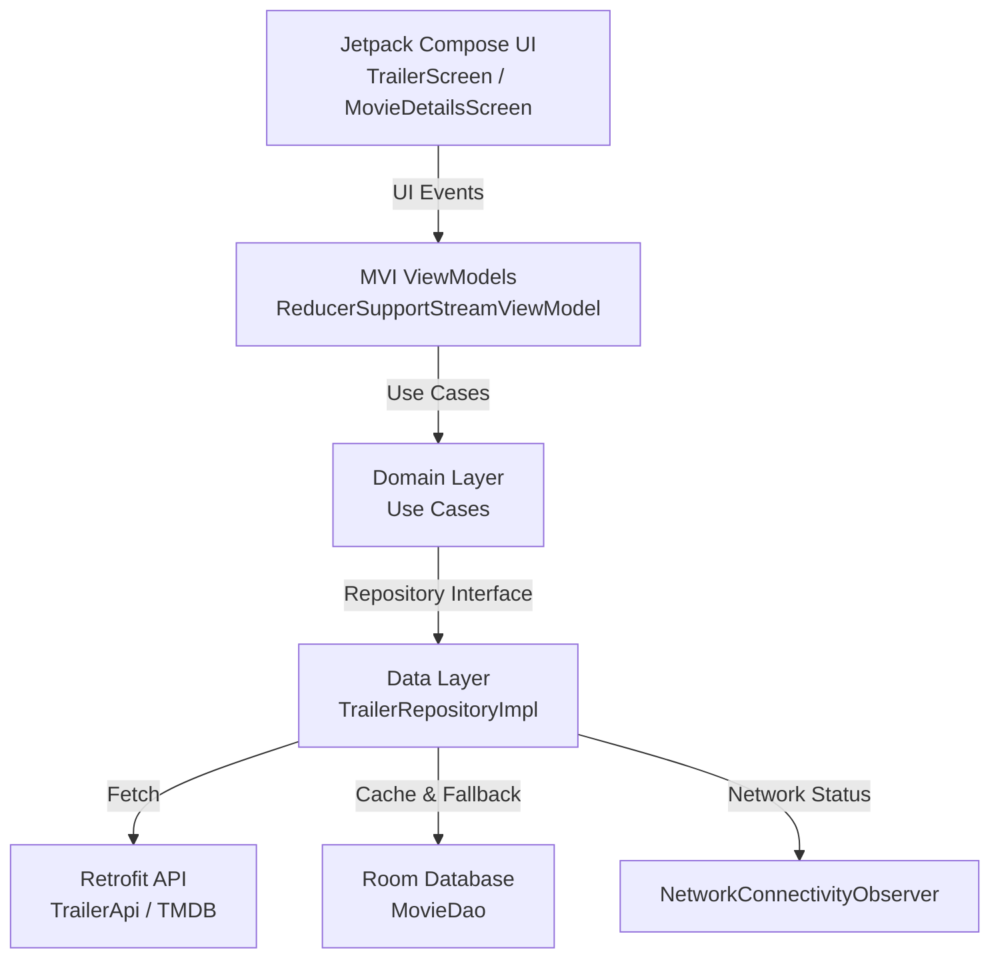

# Trailer Mobile App

A modern Android application built with Jetpack Compose, Clean Architecture, and an offline-first approach for browsing, favoriting, and watching movie trailers.

---

## 🛠️ Setup & Configuration

To run the application, you must provide your TMDB API Bearer Token in `local.properties` at the root of the project:

```properties
BEARER_TOKEN=your_tmdb_bearer_token_here
```

---

## 🏗️ General Architecture

The application follows **Clean Architecture** principles, separated across multi-module layers to ensure high modularity, testability, and separation of concerns.

### Module Structure
- **`:app`**: Entry point, Hilt application setup, navigation graph (`TrailerGraph`), and top-level UI components (such as offline banner notifications).
- **`:presentation`**: UI layer containing Jetpack Compose screens (`TrailerScreen`, `MovieDetailsScreen`, `FavoritesScreen`), ViewModels (`TrailerScreenViewModel`, `TrailerDetailsScreenViewModel`, etc.), and UI use cases.
- **`:domain`**: Business logic layer defining domain models, core use cases, and app business rules.
- **`:domain:repository`**: Domain interfaces and DTOs shared across modules (e.g., `TrailerRepository`, `NetworkConnectivityObserver`).
- **`:data`**: Data layer implementation including Room database (`TrailerDatabase`, `MovieDao`), Retrofit API (`TrailerApi`), mappers, and repository implementations (`TrailerRepositoryImpl`).
- **`:core:common`**: Shared core utilities, base Mapper definitions, and use case contracts.
- **`:core:network`**: Network configuration, OkHttp client, Retrofit setup, and error handling abstractions.
- **`:core:ui`**: Design system constants, styling, and common Compose view models / event streams (`ReducerSupportStreamViewModel`).
- **`:buildSrc`**: Gradle build configuration and version catalog management (`libs.versions.toml`).

### Architecture Schema (MVI & Clean Architecture)



---

## ⚙️ Technical Decisions & Reasoning

1. **Clean Architecture & Multi-Module Separation**:
   - Separating `:domain`, `:data`, `:presentation`, and `:core` ensures that business logic is completely independent of frameworks or data sources, making unit testing and maintenance seamless.
2. **MVI (Model-View-Intent) Pattern**:
   - Utilizes custom `ReducerSupportStreamViewModel` to process UI events, execute state transitions via explicit reducers, and output immutable UI states (`UiState`). This prevents unexpected side effects and makes UI behavior predictable.
3. **Offline-First & Robust Caching**:
   - Powered by Room and a fallback mechanism in `TrailerRepositoryImpl`. If network requests fail (or device is offline), the app gracefully falls back to cached movie entities.
4. **Jetpack Compose & Material 3**:
   - Modern declarative UI framework providing fluid animations, adaptive layouts, and reactive state collection (`collectAsState`).
5. **Dependency Injection with Hilt**:
   - Standardized constructor injection across repositories, ViewModels, and data sources for robust lifecycle management and testability.

---

## 🧪 Unit Tests

- **Data Layer Testing**:
  - `TrailerRepositoryImplTest` provides comprehensive unit test coverage for `TrailerRepositoryImpl`, verifying success API fetching, caching with preserved favorites, error fallback to local Room cache, exception re-throwing on empty cache, and reactive Flow emissions for favorite movies and favorite status using MockK, Coroutines Test (`runTest`), and Turbine.
  - Run unit tests with: `./gradlew :data:testDebugUnitTest`.

---

## 🚀 Future Improvements (If More Time Was Available)

1. **Embedded Media3 Player**:
   - Integrate Jetpack Media3 (ExoPlayer) or YouTube Android Player API to play trailers directly inline within the app.
2. **Expanded Test Coverage**:
   - Add unit tests for Presentation ViewModels, UseCases, and Compose UI / screenshot tests for UI components.
3. **Theme Toggle**:
   - Add explicit support for toggling between Light and Dark themes.
4. **Advanced Search & Filtering**:
   - Add search bar filtering across all movie categories and favorites.
